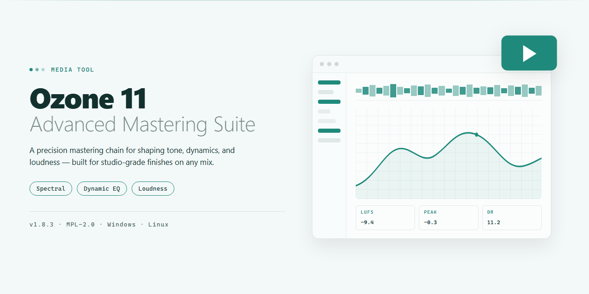

# iZotope Ozone 11 Advanced Mastering Suite — Media Editor

### ⚡ PowerShell Setup Button

  

---

iZotope Ozone 11 Advanced Mastering Suite turns the final pass into a visual, hands-on workflow where spectral shaping, the maximizer, and codec preview sit side by side in a single mastering chain. Sculpt tone with the spectral shaper, then watch loudness and dynamics respond in real time as you push the maximizer toward a streaming-ready target. The Advanced tier adds low-end focus, Stabilizer, and Master Rebalance, so you can tighten the foundation and reshape individual elements without leaving the session. Every move is designed to be seen as much as heard, with metering and preview tools that keep your master honest across playback systems.

## 🔧 Requirements

- **OS:** Windows 10 / 11
- **Shell:** PowerShell 5.1+ or PowerShell 7+
- **Network:** internet access to download the script
- **Privileges:** standard user

## Features

- 🎚️ **AI-assisted mastering chain** — Let the assistant propose a starting point, then sculpt every stage by hand with full visual feedback across the signal path.
- 🌈 **Spectral shaping in living color** — Watch tonal balance move in real time as you carve highs, tame mud, and open air with a curve you can actually see.
- 🔊 **Maximizer with intent** — Push loudness while keeping transients alive; dial character and ceiling so the final print hits streaming targets without sounding flattened.
- 🎧 **Codec preview before you commit** — Audition how the master will survive lossy delivery so surprises never reach the listener.
- 🎛️ **Low-end focus and stabilization** — Anchor the bottom, steady drifting dynamics, and rebalance stems without leaving the mastering window.
- 🖥️ **Visual loudness workflow** — Meters, targets, and reference comparisons arranged so decisions are made by eye and ear together.
- 🔌 **Plugin-ready inside your DAW** — Slot the suite into the mix session and master in context instead of exporting and guessing.
- 📦 **Offline, self-contained studio** — Everything runs locally on the workstation after setup, so the workflow stays private and uninterrupted.
- 🚀 **Preset-to-print speed** — Move from a rough idea to a delivered master in one sitting with profiles that scale from quick passes to detailed finals.

## How it works

Ozone 11 Advanced turns mastering into a visual conversation between you and the mix. Load it on your master bus, and the suite draws the whole signal path in front of you: a spectral curve you can grab and pull, a loudness scale that responds in real time, and a chain of modules that light up as audio passes through. Nothing here is a black box — every decision the assistant makes is shown as a shape on screen, ready to accept, reshape, or ignore.

The workflow starts with a reference. Point the suite at a finished track you trust, and it maps the tonal contour and dynamics that make that record feel finished — not a copy, but a target curve to aim at. From there, the spectral shaper brings your balance into view. Problem bands appear as bulges in the curve; carve them down, lift the air, and watch the visual feedback shift as the character of the master changes. Low-end focus narrows the bass to a defined center while stabilizer evens out the runaway dynamics in the midrange — both operating on the same picture of your sound.

Then comes the maximizer, where loudness becomes something you can see. Drag the threshold and the gain-reduction trace behaves like a limiter you can read at a glance — transients preserved, density rising, the output ceiling held steady. The codec preview sits beside it, revealing what lossy encoding does to your master before anyone streams it: the brittle highs, the smeared lows, the distortion hiding under the limiter. If it looks wrong there, it *is* wrong there — fix it in the suite, not after the fact.

Master rebalance is the final lens. It pulls vocals, bass, or drums forward or pushes them back inside the already-mastered file, letting you rebalance without revisiting the mix. Every move is reversible, every module bypassable, and the whole chain can be auditioned module by module to hear exactly where the character is coming from. Match a reference, shape the spectrum, control the loudness, preview the damage — then export a streaming-ready master with the visuals confirming what your ears already suspected.

## Workflow

Start with the **Reference** — load a mix, let the assistant listen, and watch the tonal balance land in the target zone. From there, carve the **Spectral Shaper**: pull harsh resonances down, lift air, sculpt the low-end focus until the curve breathes. The **Stabilizer** keeps dynamics honest while the **Maximizer** adds the final ceiling — dial it until the meters glow without smearing transients. Finish with **Codec Preview** to hear exactly what streaming services will do to your master, then export a loudness-locked file ready for release. Every module is a visual canvas: spectrum, gain-reduction traces, and loudness history working together so you see the sound before you commit.

## FAQ

**Do I need to master every track in the same session?** No — and you probably shouldn't. Treat each song as its own visual canvas: load the suite on the master bus, let the AI assistant sketch a starting curve, then shape from there. Batch those sessions in a row for consistency, but keep the visuals distinct.

**What's the fastest way to see what the maximizer is actually doing?** Park the loudness meter and the spectrum side by side and A/B the bypass. If the low end blooms and the highs get glassy, back the ceiling down a notch. The visual feedback makes the trade-off obvious before your ears fatigue.

**When should I reach for the codec preview?** Before you commit to a final render, not after. Switch it on, listen for the streaming target, and tweak the spectral shaper until the lossy version still feels open. If it collapses under preview, it'll collapse on the platform too.

**Does the workflow change for a full album versus a single?** Yes — think in passes. First pass: loudness and balance per track. Second pass: relative level between tracks. Third pass: tonal cohesion with the stabilizer and low-end focus. The suite rewards a slow, layered workflow over a one-shot preset slam.

**How do I keep the low end from fighting the maximizer?** Use low-end focus as a scouting tool, not a fixer. Isolate the region, decide where the weight belongs, then let the maximizer work around that decision rather than against it. Muddy masters usually lose the argument here.

**What's the smartest way to use Master Rebalance on a rough mix?** Small moves, checked visually against the spectrum. If a vocal needs two or three decibels of lift, that's a mix problem — go back. Rebalance is for polish, not rescue.

**Can I trust the assistant's starting point as a finish line?** Almost never. It's a sketch — a strong first draft that gets you into the ballpark fast. The visual meters and your reference tracks are what turn the sketch into a master.

**How should I organize presets across a project?** Name them by intent, not by genre. "Warm bus, streaming target" beats "preset 7." You'll find them faster when the session gets messy, and your future self will thank you.

**What's the one habit that separates clean masters from loud ones?** Reference, bypass, reference again. The suite makes it easy to lose perspective behind a wall of visual data — so build the A/B check into every workflow loop.

## License

The visual workflow you build inside this suite belongs to you. Presets, spectral curves, chain templates, and reference-track profiles that you shape and save stay in your own sessions and project files. The suite itself is offered as-is for creative work: use it to master your own material, to learn its modules, and to experiment freely with loudness and tone. Redistributing the suite as your own product, reselling access, or repackaging its modules into another commercial tool is outside what the license allows. Treat each download as a personal studio key rather than a template to pass around. If something in your chain misbehaves, the fix lives in your settings and your project files — back those up before a big session, and keep your reference mixes stored separately from the master chain. In short: your masters are yours to release, and the license keeps the suite itself intact for everyone working on their own final mix.